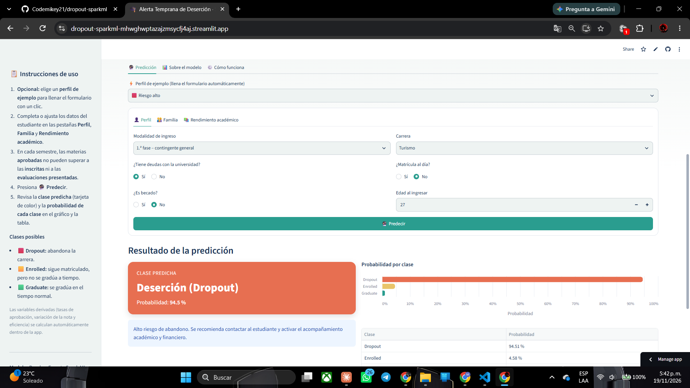
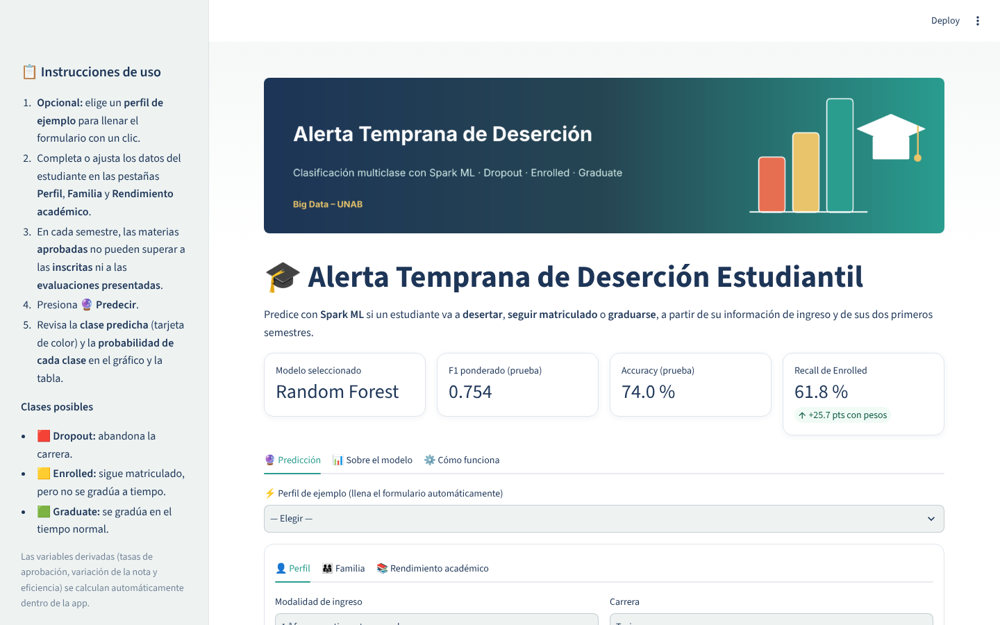
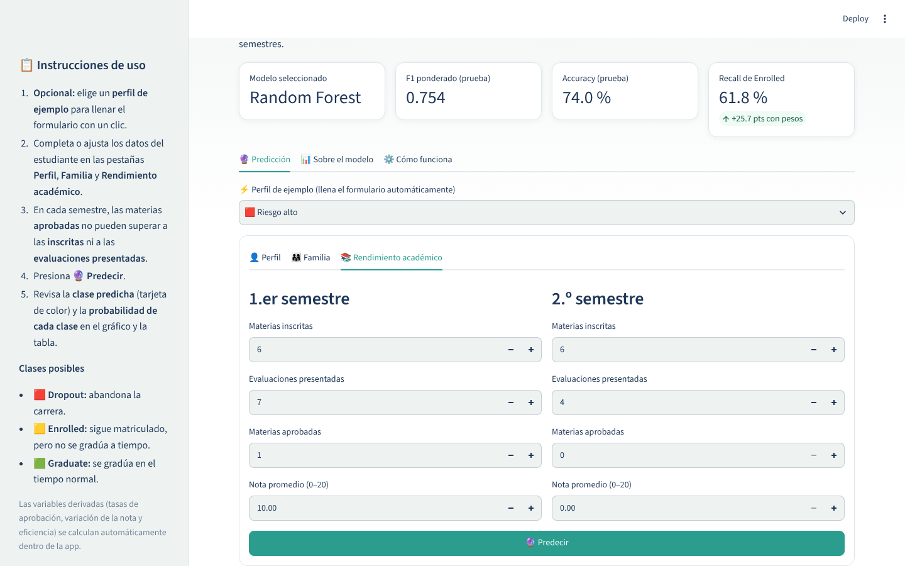
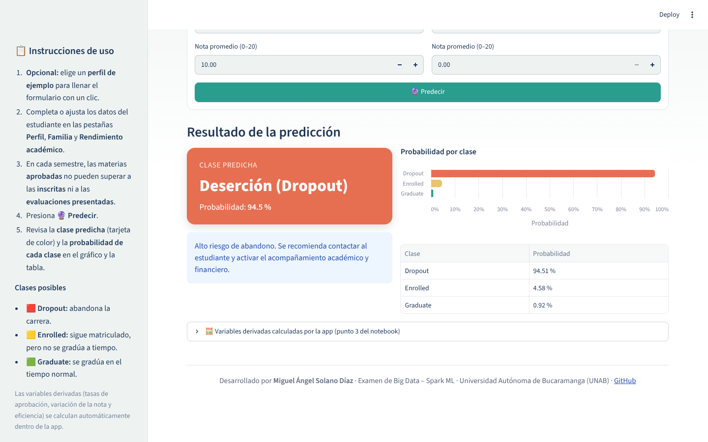
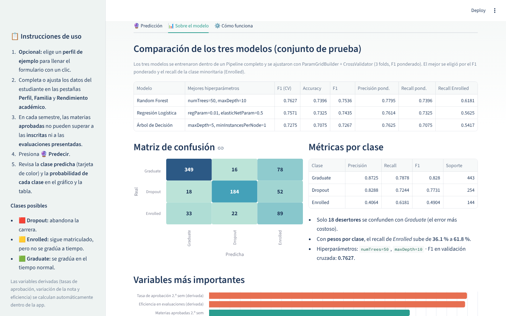

# 🎓 Alerta Temprana de Deserción Estudiantil — Spark ML + Streamlit


Aplicación web que predice si un estudiante universitario va a **desertar (Dropout)**, **seguir matriculado sin graduarse a tiempo (Enrolled)** o **graduarse (Graduate)**, con un modelo de clasificación multiclase entrenado en **Spark ML**.

🔗 **App desplegada:** https://dropout-sparkml-mhwghwptazajzmsycfj4aj.streamlit.app/
📓 **Notebook ejecutado:** [`notebook/Examen_SparkML.ipynb`](notebook/Examen_SparkML.ipynb)

---

## 📌 Descripción

Una universidad quiere identificar de forma temprana a los estudiantes en riesgo de deserción. Se usa el dataset **Predict Students' Dropout and Academic Success** (Kaggle / UCI), con **4.424 estudiantes**, variables demográficas, socioeconómicas, macroeconómicas y de rendimiento académico, y una variable objetivo con tres clases desbalanceadas:

| Clase | Estudiantes | % |
|---|---|---|
| Graduate | 2.209 | 49,9 % |
| Dropout | 1.421 | 32,1 % |
| Enrolled (minoritaria) | 794 | 17,9 % |

## 🧪 Notebook (Google Colab)

| Sección | Contenido |
|---|---|
| **A. Carga, limpieza, ingeniería y partición** | SparkSession con máximo 4 particiones · detección automática del separador · esquema, dimensiones y distribución de clases · normalización de columnas con regex · duplicados, nulos y tipos · `StringIndexer` de `Target` fuera del pipeline (orden de `labels` guardado) · `randomSplit` 80/20 con semilla 42 |
| **Ingeniería de características** | 5 variables derivadas con control de división por cero: `tasa_aprob_1sem`, `tasa_aprob_2sem`, `variacion_nota`, `variacion_tasa_aprob`, `eficiencia_evaluaciones` · categóricas con `StringIndexer(handleInvalid="keep")` + `OneHotEncoder` · `VectorAssembler` + `StandardScaler` dentro del Pipeline · selección de variables con `featureImportances` del Random Forest (39 → 23 variables) validada con CV |
| **B. Pipelines e hiperparametrización** | Regresión Logística (`family="multinomial"`), Random Forest y Árbol de Decisión, cada uno en un Pipeline completo · `ParamGridBuilder().build()` + `CrossValidator(numFolds=3)` con F1 ponderado |
| **C. Evaluación y guardado** | Accuracy, F1, precisión y recall ponderados en el conjunto de prueba · matriz de confusión · prueba de control de los pesos por clase · `bestModel.write().overwrite().save("modelo_final")` + ZIP |

**Estrategia de desbalance:** pesos por clase (`weightCol`, $w_c = N / (K \cdot N_c)$, calculados solo con el entrenamiento) y F1 ponderado como métrica de selección.

## 🏆 Resultados (conjunto de prueba)

| Modelo | Mejores hiperparámetros | F1 (CV) | Accuracy | **F1** | Precisión pond. | Recall pond. | Recall Enrolled |
|---|---|---|---|---|---|---|---|
| **Random Forest** ✅ | numTrees=50, maxDepth=10 | 0,7627 | 0,7396 | **0,7536** | 0,7795 | 0,7396 | **0,6181** |
| Regresión Logística | regParam=0.01, elasticNetParam=0.5 | 0,7571 | 0,7325 | 0,7435 | 0,7614 | 0,7325 | 0,5625 |
| Árbol de Decisión | maxDepth=5, minInstancesPerNode=1 | 0,7275 | 0,7075 | 0,7267 | 0,7625 | 0,7075 | 0,5417 |

- El **Random Forest** fue el mejor en validación cruzada y en prueba, y el que mejor detecta la clase minoritaria.
- Con pesos por clase, el recall de *Enrolled* sube de **36,1 %** a **61,8 %**.
- Solo 18 de 254 desertores (7 %) se confunden con *Graduate*.

## 🖥️ La aplicación

1. **(a)** Carga el mejor modelo con `PipelineModel.load` y mantiene Spark y el modelo en memoria con `@st.cache_resource`.
2. **(b)** Formulario (`st.form`) con todas las variables que usa el modelo, organizadas en pestañas, con el botón **Predecir** y **perfiles de ejemplo** para probar con un clic.
3. **(c)** Calcula dentro de la app las mismas 5 variables derivadas del notebook.
4. **(d)** Convierte los datos en un DataFrame de Spark con los tipos exactos del entrenamiento (`schema_entrada.json`) y aplica el modelo.
5. **(e)** Muestra la clase predicha destacada, traducida con el orden de `labels` del `StringIndexer`, y la probabilidad de cada clase en un gráfico y una tabla.
6. **Extra:** la pestaña *Sobre el modelo* muestra la comparación de modelos, la matriz de confusión, las métricas por clase y las variables más importantes; la pestaña *Cómo funciona* explica el flujo de datos.

### Capturas de la app funcionando

**App desplegada en Streamlit Community Cloud** (URL pública visible): perfil de riesgo alto → *Deserción (Dropout)* con 94,5 %


**Inicio:** indicadores del modelo, perfiles de ejemplo y formulario


**Formulario:** perfil de riesgo alto cargado en la pestaña *Rendimiento académico*


**Resultado:** clase predicha destacada y probabilidad de cada clase (gráfico + tabla)


**Sobre el modelo:** comparación de modelos, matriz de confusión, métricas por clase e importancia de variables


## 📁 Estructura del repositorio

```
├── app.py                    # Aplicación de Streamlit
├── modelo_final/             # PipelineModel de Spark ML + labels.json + schema_entrada.json
├── modelo_final.zip          # Carpeta del modelo comprimida
├── notebook/                 # Notebook ejecutado de Google Colab (.ipynb)
├── assets/                   # Banner y métricas del modelo
├── capturas/                 # Capturas de la app funcionando
├── .streamlit/config.toml    # Tema visual
├── requirements.txt          # streamlit, pyspark, pandas
└── packages.txt              # default-jre (Java para Spark)
```

## ▶️ Cómo ejecutarla localmente

Requisitos: Python 3.10 a 3.12 y **Java 17 o superior** (Spark lo necesita).

```bash
git clone https://github.com/Codemikey21/dropout-sparkml.git
cd dropout-sparkml
python -m venv .venv
# Windows: .venv\Scripts\activate   |   Linux/Mac: source .venv/bin/activate
pip install -r requirements.txt
streamlit run app.py
```

## ☁️ Despliegue en Streamlit Community Cloud

1. Subir el repositorio a GitHub.
2. En [share.streamlit.io](https://share.streamlit.io): **Create app** → elegir el repositorio, la rama `main` y el archivo `app.py` → **Deploy**.
3. `packages.txt` instala Java (`default-jre`) y `requirements.txt` instala **PySpark 4.0.5**, la misma versión con la que se entrenó el modelo en Colab.

## 👤 Autor

**Miguel Ángel Solano Díaz** · Ingeniería de Sistemas · Universidad Autónoma de Bucaramanga (UNAB)
